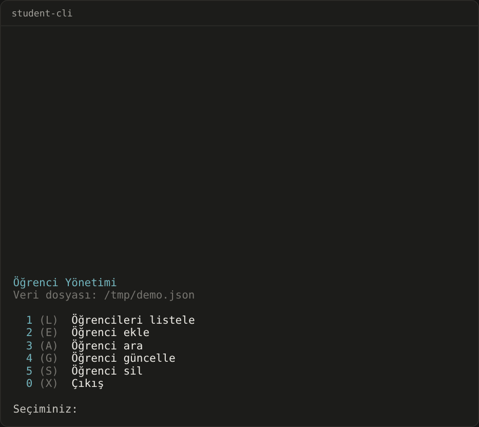
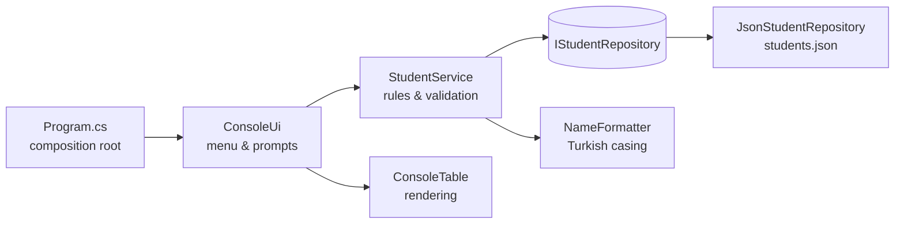

# Student CLI

[](https://github.com/Beratoguzhan620/student-cli/actions/workflows/ci.yml)


**English** · [Türkçe](README.tr.md)

A small, dependency-free console app for managing a student list: add, list, search, update and delete students, with data saved to a JSON file.



## Features

- Add, list, search, update and delete students from a numbered menu (letter shortcuts work too)
- Data is stored in `students.json` and survives restarts; sample students are created only on first run
- Input never crashes the app: numbers are parsed safely, blank input cancels, and every action asks for confirmation
- Names are normalised with Turkish casing rules (`"  aYŞE   nur"` → `Ayşe Nur`, `irem` → `İrem`)
- Search by name, surname, student number or section, case-insensitively
- Box-drawn, colour-coded tables without third-party packages
- Atomic saves (write to a temp file, then swap) so a crash never corrupts the data file

## Tech stack

- .NET 10, C# (nullable reference types, warnings as errors)
- `System.Text.Json` for persistence
- xUnit for tests, GitHub Actions for CI

## Architecture



| Folder | Responsibility |
|---|---|
| `src/StudentCli/Models` | `Student` entity |
| `src/StudentCli/Services` | Business rules: validation, duplicate checks, search, ordering |
| `src/StudentCli/Data` | Storage abstraction and the JSON implementation, sample data |
| `src/StudentCli/Cli` | Menu loop, prompts and table rendering |
| `tests/StudentCli.Tests` | Unit tests for the service, repository, formatter and table |

The UI only talks to `StudentService`, and the service only talks to `IStudentRepository`. That keeps the rules testable with an in-memory repository and makes it easy to swap JSON for a database later.

## Getting started

Requirements: [.NET 10 SDK](https://dotnet.microsoft.com/download)

```bash
git clone https://github.com/Beratoguzhan620/student-cli.git
cd student-cli
dotnet run --project src/StudentCli
```

By default data is written to `students.json` in the current folder. To use another file:

```bash
dotnet run --project src/StudentCli -- --data ~/school/students.json
```

## Running tests

```bash
dotnet test StudentCli.slnx
```

## Roadmap

See [docs/ROADMAP.md](docs/ROADMAP.md).

## Background

This project started as a bootcamp project and was later rebuilt from the ground up. The original was a .NET 7 console app with everything in `Program.cs` and the student list kept in memory. What this version adds:

- **Structure:** `Program.cs` only starts the app; the menu is in `ConsoleUi`, the rules in `StudentService` and the storage in `JsonStudentRepository`.
- **Data:** students saved to `students.json` with atomic writes; sample students only on the first run.
- **Features:** search and update, Turkish-aware name casing, and confirmations before changes.
- **Robust input:** numbers parsed safely, and blank input cancels instead of crashing.
- **Output:** colour-coded, box-drawn tables from a small `ConsoleTable` class, with no third-party packages.
- **Quality:** xUnit tests, .NET 10 with warnings as errors, and CI on every pull request.

## License

[MIT](LICENSE) · Berat Oğuzhan Turğut · [GitHub](https://github.com/Beratoguzhan620)
