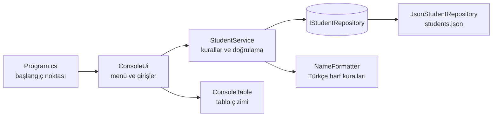

# Student CLI

[](https://github.com/Beratoguzhan620/student-cli/actions/workflows/ci.yml)


[English](README.md) · **Türkçe**

Öğrenci listesini yönetmek için harici paket kullanmayan küçük bir konsol uygulaması: öğrenci ekleme, listeleme, arama, güncelleme ve silme. Veriler bir JSON dosyasında saklanır.


## Özellikler

- Numaralı menüden ekleme, listeleme, arama, güncelleme ve silme (harf kısayolları da çalışır)
- Veriler `students.json` dosyasında kalıcıdır; örnek öğrenciler yalnızca ilk açılışta oluşturulur
- Hatalı giriş uygulamayı çökertmez: sayılar güvenli şekilde okunur, boş giriş işlemi iptal eder, her işlem onay ister
- İsimler Türkçe büyük/küçük harf kurallarıyla düzenlenir (`"  aYŞE   nur"` → `Ayşe Nur`, `irem` → `İrem`)
- Ad, soyad, öğrenci numarası veya şubeye göre büyük/küçük harf duyarsız arama
- Harici paket olmadan çerçeveli ve renkli tablolar
- Atomik kayıt (önce geçici dosyaya yazılır, sonra değiştirilir); program çökse bile veri dosyası bozulmaz

## Teknolojiler

- .NET 10, C# (nullable reference types, uyarılar hata sayılır)
- Kalıcılık için `System.Text.Json`
- Testler için xUnit, CI için GitHub Actions

## Mimari



| Klasör | Görevi |
|---|---|
| `src/StudentCli/Models` | `Student` varlığı |
| `src/StudentCli/Services` | İş kuralları: doğrulama, mükerrer kontrolü, arama, sıralama |
| `src/StudentCli/Data` | Depolama soyutlaması, JSON uygulaması ve örnek veriler |
| `src/StudentCli/Cli` | Menü döngüsü, kullanıcı girişleri ve tablo çizimi |
| `tests/StudentCli.Tests` | Servis, depo, biçimlendirici ve tablo için birim testleri |

Arayüz yalnızca `StudentService` ile, servis de yalnızca `IStudentRepository` ile konuşur. Böylece kurallar bellek içi bir depoyla test edilebilir ve ileride JSON yerine veritabanı kullanmak kolaylaşır.

## Kurulum

Gereksinim: [.NET 10 SDK](https://dotnet.microsoft.com/download)

```bash
git clone https://github.com/Beratoguzhan620/student-cli.git
cd student-cli
dotnet run --project src/StudentCli
```

Veriler varsayılan olarak bulunduğunuz klasördeki `students.json` dosyasına yazılır. Başka bir dosya kullanmak için:

```bash
dotnet run --project src/StudentCli -- --data ~/okul/ogrenciler.json
```

## Testleri çalıştırma

```bash
dotnet test StudentCli.slnx
```

## Yol haritası

[docs/ROADMAP.md](docs/ROADMAP.md)

## Arka plan

Bu proje bir bootcamp projesi olarak başladı, sonra baştan geliştirildi. İlk hali, her şeyin `Program.cs` içinde olduğu ve öğrenci listesinin bellekte tutulduğu bir .NET 7 konsol uygulamasıydı. Bu sürümde eklenenler:

- **Yapı:** `Program.cs` yalnızca uygulamayı başlatıyor; menü `ConsoleUi`'da, kurallar `StudentService`'te, kayıt işleri `JsonStudentRepository`'de.
- **Veri:** öğrenciler `students.json` dosyasına güvenli (atomik) yazmayla kaydediliyor; örnek öğrenciler yalnızca ilk açılışta.
- **Özellikler:** arama ve güncelleme, Türkçe kurallara uygun ad düzeltme, değişikliklerden önce onay.
- **Sağlam giriş:** sayılar güvenle ayrıştırılıyor; boş giriş çökme yerine işlemi iptal ediyor.
- **Çıktı:** harici paket kullanmadan, küçük bir `ConsoleTable` sınıfıyla renkli ve çerçeveli tablolar.
- **Kalite:** xUnit testleri, uyarıların hata sayıldığı .NET 10 ve her pull request'te CI.

## Lisans

[MIT](LICENSE) · Berat Oğuzhan Turğut · [GitHub](https://github.com/Beratoguzhan620)
